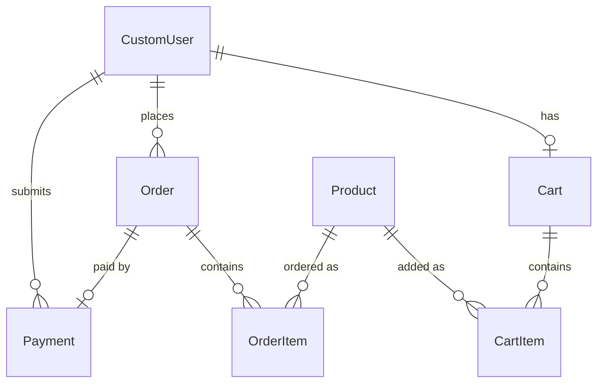

# Django E-Commerce Store

A full-stack e-commerce web application built with **Django 6** and **Bootstrap 5**.
Customers can browse products, manage a shopping cart, place orders and pay by bank transfer with proof upload.
Store staff get a separate dashboard to track sales, low stock and verify payments.

Built by **Saneed Ullah** as a portfolio project after completing the
[Meta Back-End Developer Professional Certificate](https://coursera.org/verify/professional-cert/4W3OG3MVRKBW).

---

## Features

### Customers
- Sign up, log in, log out and view profile (custom user model with phone, address and profile picture)
- Browse the product catalogue and view product details with images
- Shopping cart: add items, change quantity, remove items, live total
- Checkout with delivery details; prices are saved per order item at the time of purchase
- Order history and order detail pages with status tracking
  (`pending → processing → shipped → delivered` or `cancelled`)
- Bank-transfer payment: submit a transaction reference and upload a payment screenshot

### Store staff
- Separate staff login page
- Admin dashboard: total products, total orders, pending orders, revenue, pending payments,
  low-stock alerts (< 5 items) and recent orders
- Add new products or restock existing ones from one page
- Payment requests dashboard: verify, reject or mark payments as not received
  - Verified → order moves to **processing**
  - Rejected → order is **cancelled**
- JSON endpoint with the number of pending payments (for live notification badges)
- Django admin with order items shown inline and a bulk "mark payments verified" action

---

## Tech Stack

| Layer | Technology |
|---|---|
| Language | Python 3.12 |
| Framework | Django 6.1 |
| Database | SQLite (development) |
| Frontend | Django Templates, Bootstrap 5.3, Bootstrap Icons |
| Images | Pillow (product images, profile pictures, payment proofs) |
| Auth | Django authentication with a custom user model |

---

## Project Structure

```
ecommerce_project/
├── ecommerce_project/   # Project settings and root URLs
├── accounts/            # Custom user model, signup, login, profile, staff login
├── products/            # Product model, catalogue, add / restock products
├── cart/                # Cart and cart items (one cart per user)
├── orders/              # Checkout, orders, order items, order history
├── payments/            # Bank-transfer payments, proof upload, staff verification
├── core/                # Home page, staff dashboard, base templates
├── static/              # CSS and JavaScript
├── media/               # Uploaded files (not committed)
├── manage.py
├── requirements.txt
└── .env.example         # Environment variable template
```

## Data Model



---

## Getting Started

### 1. Clone the repository
```bash
git clone <your-repo-url>
cd ecommerce_project
```

### 2. Create and activate a virtual environment
```bash
python -m venv venv
# Windows
venv\Scripts\activate
# macOS / Linux
source venv/bin/activate
```

### 3. Install dependencies
```bash
pip install -r requirements.txt
```

### 4. Set up environment variables
Copy `.env.example` to `.env` and set your own secret key:
```bash
python -c "from django.core.management.utils import get_random_secret_key; print(get_random_secret_key())"
```
Paste the output as `DJANGO_SECRET_KEY` in `.env`.

| Variable | Description | Example |
|---|---|---|
| `DJANGO_SECRET_KEY` | Django secret key (required) | `k3$x...` |
| `DJANGO_DEBUG` | Debug mode | `True` for development |
| `DJANGO_ALLOWED_HOSTS` | Comma-separated host names | `example.com,www.example.com` |

### 5. Create the database and an admin user
```bash
python manage.py migrate
python manage.py createsuperuser
```

### 6. Run the server
```bash
python manage.py runserver
```

---

## Main Pages

| Page | URL |
|---|---|
| Home | `/core/` |
| Products | `/products/` |
| Product detail | `/products/<id>/` |
| Cart | `/cart/` |
| Checkout | `/orders/checkout/` |
| My orders | `/orders/history/` |
| Sign up / Log in | `/accounts/signup/`, `/accounts/login/` |
| Staff login | `/accounts/admin-login/` |
| Staff dashboard | `/core/dashboard/` |
| Add / restock products | `/products/add/` |
| Payment requests | `/payments/dashboard/` |
| Django admin | `/admin/` |

---

## Order and Payment Flow

1. The customer adds products to the cart and checks out with delivery details.
2. An order is created with status **pending** and the cart is emptied.
3. The customer transfers the amount to the store's bank account and submits the
   transaction reference with a screenshot.
4. Staff review the request on the payment dashboard:
   - **Verify** → order becomes **processing**
   - **Reject** → order becomes **cancelled**
   - **Not received** → order stays as it is while staff investigate
5. Staff update the order to **shipped** and **delivered** from the Django admin.

---

## Roadmap

- [ ] REST API with Django REST Framework (products, cart, orders, token authentication)
- [ ] Interactive API documentation (Swagger / OpenAPI)
- [ ] Automatic stock deduction and stock checks at checkout
- [ ] Unit tests for all apps
- [ ] Product categories, search, filtering and pagination
- [ ] Online card payments (Stripe test mode)
- [ ] Deployment with PostgreSQL

---

## Author

**Saneed Ullah**: Django back-end developer and Data Science student
Meta Back-End Developer Professional Certificate (Coursera, 2026)
