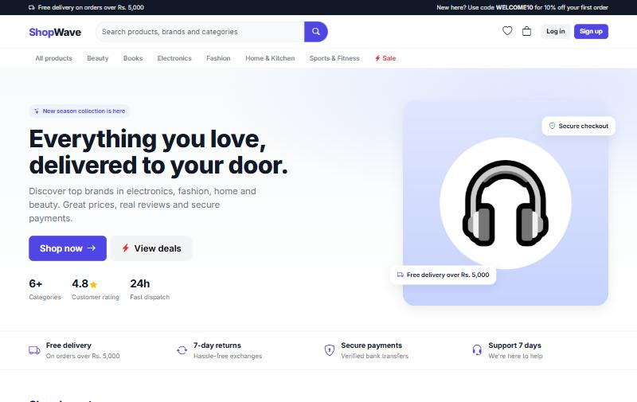
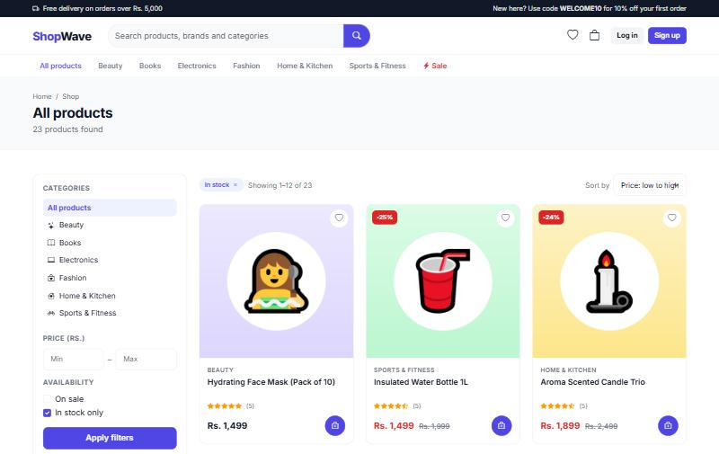
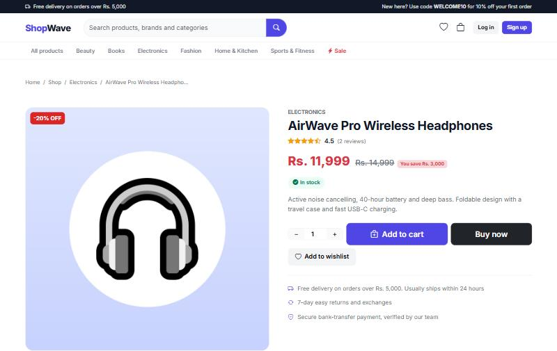
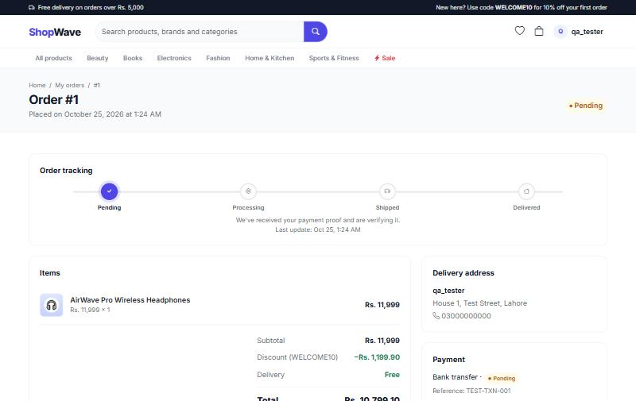
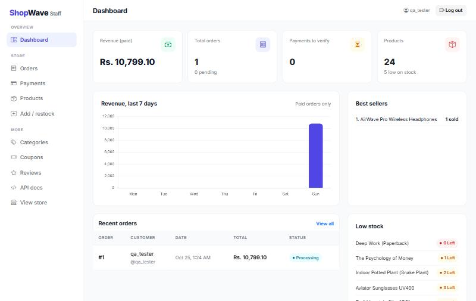
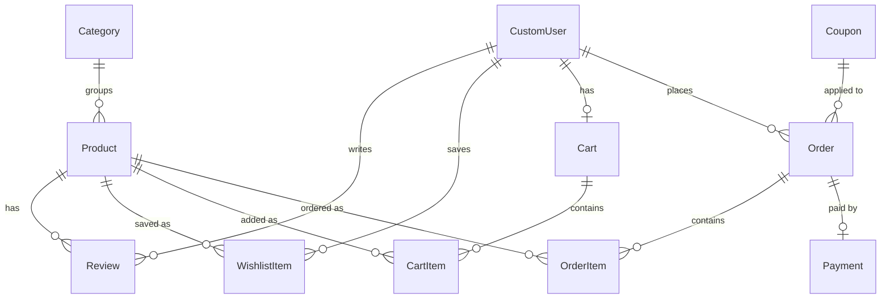

# ShopWave: Django E-Commerce Store

A full-featured e-commerce web application built with **Django 6**, **Django REST Framework** and **Bootstrap 5**.
Customers browse a categorised catalogue, filter and search products, save favourites, apply coupon codes,
check out, pay by bank transfer and track their orders. Store staff run everything from a dedicated dashboard
with sales charts, order management and payment verification. Every feature is also available through a
**token-authenticated REST API** with interactive **Swagger docs**.

Built by **Saneed Ullah** as a portfolio project after completing the
[Meta Back-End Developer Professional Certificate](https://coursera.org/verify/professional-cert/4W3OG3MVRKBW).



| Shop with filters | Product page |
|---|---|
|  |  |
| **Order tracking** | **Staff dashboard** |
|  |  |

---

## Features

### Storefront
- Modern, responsive design (Bootstrap 5.3, Inter font, custom design system)
- Home page with hero, category tiles, featured products, weekly deals and new arrivals
- **Categories**, full-text **search**, **filters** (price range, on sale, in stock), **sorting**
  (newest, price, top rated, name) and **pagination**
- **Sale prices** with automatic % off badges and "you save" amounts
- **Ratings and reviews**: only customers with a paid order can review (verified purchase), with a rating breakdown
- **Wishlist** with heart buttons that update instantly (AJAX)
- Related products, stock indicators ("only 3 left") and a quantity selector with *Buy now*

### Cart, checkout and orders
- Cart with live totals, quantity limits based on stock and **coupon codes** (percentage or fixed amount,
  minimum order, expiry date and usage limits)
- Checkout pre-filled from the customer's saved profile
- Stock is checked and deducted safely at checkout (database row locking) and restored on cancellation
- **Order tracking timeline** (`pending → processing → shipped → delivered`), order history with status filters
- Customers can cancel pending orders
- Bank-transfer payment: upload a transaction reference and/or a receipt screenshot

### Accounts
- Sign up, log in (with redirect back to the page you were on), log out
- Profile page with stats (orders, total spent, wishlist, reviews) and editable delivery details and picture

### Staff panel
- Sidebar dashboard: revenue, orders, payments waiting for review, low-stock alerts, best sellers,
  recent orders and a **7-day revenue chart** (Chart.js)
- **Orders**: search, filter by status and change status in one click
- **Payments**: verify / reject / mark not received (rejecting cancels the order and restocks items),
  live pending-payment badge
- **Products**: list, search, filter, add, edit, restock and delete
- Categories, coupons and reviews managed through the Django admin

### REST API
- Token authentication: register, log in, log out, view and edit your profile
- Products with search, filters, ordering and pagination; categories; reviews
- Cart, wishlist, coupon preview, checkout with coupons, order cancel, payment submission
- Staff endpoints for products, order status and payment review
- Interactive documentation with Swagger UI and ReDoc (OpenAPI 3 schema)

### Quality
- Business logic (checkout, coupons, order and payment status) lives in service functions shared by the
  website and the API
- **55 automated tests** covering the API, website flows, permissions, coupons, stock and the demo-data command
- Secrets loaded from `.env`; demo data command for a ready-to-show store

---

## Tech Stack

| Layer | Technology |
|---|---|
| Language | Python 3.12 |
| Framework | Django 6.1 |
| API | Django REST Framework 3.18, token authentication |
| API docs | drf-spectacular (OpenAPI 3, Swagger UI, ReDoc) |
| Database | SQLite (development) |
| Frontend | Django Templates, Bootstrap 5.3, Bootstrap Icons, Chart.js, vanilla JavaScript |
| Images | Pillow (product images, profile pictures, payment proofs, generated demo images) |

---

## Project Structure

```
ecommerce_project/
├── ecommerce_project/   # Settings, root URLs and API URLs (api_urls.py)
├── accounts/            # Custom user model, signup, login, profile, staff login
├── products/            # Categories, products, reviews, wishlist, staff product management
│   └── management/commands/seed_demo.py   # demo catalogue generator
├── cart/                # Cart, cart items and coupon handling
├── orders/              # Coupons, checkout, orders, order tracking, cancellations
├── payments/            # Bank-transfer payments, proof upload, staff verification
├── core/                # Home page, staff dashboard, layouts, partials, template tags
│
│   Each app contains:
│   ├── models.py, views.py, urls.py, forms.py, templates/   # website
│   ├── serializers.py, api_views.py                         # REST API
│   ├── services.py                                          # shared business logic (orders, payments)
│   └── tests.py / test_*.py
├── static/              # CSS design system and JavaScript
├── docs/screenshots/    # README images
├── media/               # Uploaded files (not committed)
├── requirements.txt
└── .env.example         # Environment variable template
```

## Data Model



---

## Getting Started

### 1. Clone the repository
```bash
git clone https://github.com/saneedkhani/ecommerce-store.git
cd ecommerce-store
```

### 2. Create and activate a virtual environment
```bash
python -m venv venv
# Windows
venv\Scripts\activate
# macOS / Linux
source venv/bin/activate
```

### 3. Install dependencies
```bash
pip install -r requirements.txt
```

### 4. Set up environment variables
Copy `.env.example` to `.env` and set your own secret key:
```bash
python -c "from django.core.management.utils import get_random_secret_key; print(get_random_secret_key())"
```

| Variable | Description | Example |
|---|---|---|
| `DJANGO_SECRET_KEY` | Django secret key (required) | `k3$x...` |
| `DJANGO_DEBUG` | Debug mode | `True` for development |
| `DJANGO_ALLOWED_HOSTS` | Comma-separated host names | `example.com,www.example.com` |
| `STORE_ACCOUNT_TITLE`, `STORE_ACCOUNT_NUMBER`, `STORE_BANK_NAME` | Bank details shown on the payment page | `ShopWave Pvt Ltd` |

### 5. Create the database, an admin user and the demo store
```bash
python manage.py migrate
python manage.py createsuperuser
python manage.py seed_demo
```
`seed_demo` creates 6 categories, 24 products with generated images, sample reviews and three coupon codes:
**WELCOME10** (10% off), **SAVE500** (Rs. 500 off orders over Rs. 3,000) and **FLASH20** (20% off orders over Rs. 10,000).
Run it again any time; it never duplicates data. `python manage.py seed_demo --reset` deletes all products first.

### 6. Run the server
```bash
python manage.py runserver
```
- Store: http://127.0.0.1:8000/
- Staff dashboard: http://127.0.0.1:8000/dashboard/ (log in with a staff account)
- API docs (Swagger): http://127.0.0.1:8000/api/docs/

### 7. Run the tests
```bash
python manage.py test
```

---

## REST API

Base URL: `/api/`. Interactive docs: **`/api/docs/`** (Swagger UI) and **`/api/redoc/`** (ReDoc). Raw schema: `/api/schema/`.

### Authentication
Log in to get a token, then send it with every request:
```
Authorization: Token <your-token>
```
In Swagger UI, click **Authorize** and enter `Token <your-token>`.

### Endpoints

| Method | Endpoint | Who | Description |
|---|---|---|---|
| POST | `/api/auth/register/` | Anyone | Create an account, returns a token |
| POST | `/api/auth/login/` | Anyone | Log in, returns a token |
| POST | `/api/auth/logout/` | User | Delete your token |
| GET / PATCH | `/api/auth/me/` | User | View / update your profile |
| GET | `/api/categories/` | Anyone | List categories |
| GET | `/api/products/` | Anyone | List products (`?search=`, `?category=`, `?min_price=`, `?max_price=`, `?on_sale=true`, `?in_stock=true`, `?featured=true`, `?ordering=effective_price`, `?page=`) |
| GET | `/api/products/{id}/` | Anyone | Product details with rating |
| GET / POST | `/api/products/{id}/reviews/` | Anyone / buyer | List reviews / post a review |
| POST / PUT / PATCH / DELETE | `/api/products/`, `/api/categories/` … | Staff | Manage the catalogue |
| GET / POST | `/api/wishlist/` | User | List / add (`product_id`) |
| DELETE | `/api/wishlist/{id}/` | User | Remove from wishlist |
| GET / DELETE | `/api/cart/` | User | View / empty your cart |
| POST | `/api/cart/items/` | User | Add a product (`product_id`, `quantity`) |
| PATCH / DELETE | `/api/cart/items/{id}/` | User | Change quantity / remove item |
| POST | `/api/orders/check-coupon/` | User | Preview a coupon on your cart (`code`) |
| POST | `/api/orders/checkout/` | User | Place an order (optional `coupon_code`) |
| GET | `/api/orders/` | User | Your orders with timeline (staff see all, `?status=`) |
| GET | `/api/orders/{id}/` | User | Order details |
| POST | `/api/orders/{id}/cancel/` | User | Cancel a pending order |
| POST | `/api/orders/{id}/payment/` | User | Submit payment proof (`bank_reference`, `proof_screenshot`) |
| POST | `/api/orders/{id}/status/` | Staff | Set order status |
| GET | `/api/payments/` | Staff | All payments (`?status=pending`) |
| POST | `/api/payments/{id}/status/` | Staff | Set `verified`, `rejected` or `not_received` |

### Example: log in, add to cart and check out with a coupon
```bash
curl -X POST http://127.0.0.1:8000/api/auth/login/ \
     -d "username=alice&password=your-password"
# {"token": "<your-token>", "user": {...}}

curl -X POST http://127.0.0.1:8000/api/cart/items/ \
     -H "Authorization: Token <your-token>" \
     -d "product_id=1&quantity=2"

curl -X POST http://127.0.0.1:8000/api/orders/checkout/ \
     -H "Authorization: Token <your-token>" \
     -d "full_name=Alice&address=1 Main St&phone_number=03001234567&coupon_code=WELCOME10"
```

---

## Main Pages

| Page | URL |
|---|---|
| Home | `/` |
| Shop / category / search | `/products/`, `/products/category/<slug>/`, `/products/?q=` |
| Product detail and reviews | `/products/<id>/` |
| Wishlist | `/products/wishlist/` |
| Cart and coupons | `/cart/` |
| Checkout | `/orders/checkout/` |
| My orders / order tracking | `/orders/history/`, `/orders/<id>/` |
| My account | `/accounts/profile/` |
| Staff dashboard | `/dashboard/` |
| Staff orders / products / payments | `/dashboard/orders/`, `/dashboard/products/`, `/payments/dashboard/` |
| Django admin (categories, coupons, reviews) | `/admin/` |

---

## Order and Payment Flow

1. The customer adds products to the cart, optionally applies a coupon and checks out.
2. An order is created with status **pending**, stock is deducted and the cart is emptied.
3. The customer transfers the amount and submits the transaction reference and/or a receipt screenshot.
4. Staff review it on the payments page:
   - **Verify** → order becomes **processing**
   - **Reject** → order is **cancelled** and the items go back in stock
   - **Not received** → order stays as it is while staff investigate
5. Staff move the order to **shipped** and **delivered** from the orders page; the customer sees each step
   on the tracking timeline and can then review the products.

---

## Roadmap

- [x] REST API with token authentication and Swagger docs
- [x] Categories, search, filters, sorting and pagination
- [x] Reviews and ratings, wishlist, sale prices and coupon codes
- [x] Order tracking, customer cancellations and a staff order panel
- [x] Automated tests
- [ ] Online card payments (Stripe test mode)
- [ ] Email notifications for order updates
- [ ] Deployment with PostgreSQL

---

## Author

**Saneed Ullah**: Django back-end developer and Data Science student
Meta Back-End Developer Professional Certificate (Coursera, 2026)
